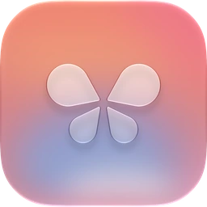

<p align="center"></p>

<h1 align="center">Charland</h1>

<p align="center">The notch of your Mac, brought to life.<br>Free and open source.</p>

<p align="center">
  <a href="https://github.com/carpaaaaa/charland/releases/latest"><b>Download</b></a> ·
  <a href="https://charland.charstudio.app">Website</a> ·
  <a href="https://charland.charstudio.app/changelog">Changelog</a> ·
  <a href="CONTRIBUTING.md">Contribute</a> ·
  <a href="https://buymeacoffee.com/charstudio">Buy us a coffee</a>
</p>

<p align="center"></p>

Charland turns the notch (or a pill at the top of the screen, on Macs without one) into a place for what you reach
for all day: dictation, music, timers, your AI agents, your calendar and a tray for files.

## What it does

- **Dictation.** Hold ⌥Z, talk, let go: the text lands where your cursor is. The speech model runs on your Mac, you
  see the words while you talk, and your own vocabulary is favoured.
- **AI agents.** Claude Code and Codex sessions show up in the island. Approve, deny or answer without switching apps.
- **Music.** Whatever is playing, with its cover and controls, and lyrics on the Lock Screen.
- **Every edge of the screen.** Volume and brightness as a pill of glass, timers and clipboard history from the menu
  bar, glass widgets next to the Dock, a day ruler on the side, a file tray with AirDrop.
- **An open API.** Scripts, Shortcuts and your own apps can show progress and approvals in the island
  ([docs/API.md](docs/API.md)).

<p align="center"></p>
<p align="center"></p>

## Install

Download the latest `Charland.dmg` from [Releases](https://github.com/carpaaaaa/charland/releases/latest) or from the
[website](https://charland.charstudio.app), open it and drag Charland to Applications. It is signed and notarized, and
it updates itself.

Requires a Mac with Apple silicon and macOS 26 or later. The speech model is downloaded the first time you turn on
dictation.

## Build from source

You need Xcode 27 and [XcodeGen](https://github.com/yonaskolb/XcodeGen) (`brew install xcodegen`).

```bash
git clone https://github.com/carpaaaaa/charland.git
cd charland
cp Config/Local.xcconfig.example Config/Local.xcconfig
Scripts/scarica-dipendenze.sh
Scripts/build.sh
```

`Local.xcconfig` signs the app ad hoc, so no Apple account is needed. `scarica-dipendenze.sh` downloads and builds the
pinned speech engine. Tests: `swift test` in `Packages/CharlandCore` and `Packages/CharlandKit`. Everything else,
including how to keep macOS permissions between builds, is in [CONTRIBUTING.md](CONTRIBUTING.md).

## Contributing

Bug reports, ideas and pull requests are welcome. Start with [CONTRIBUTING.md](CONTRIBUTING.md). If Charland is
useful to you, a star on GitHub helps others find it, and you can [buy us a coffee](https://buymeacoffee.com/charstudio).
Companies can [sponsor Charland](https://charland.charstudio.app/sponsors). Charland was first
written in Italian, so many code comments are in Italian; new code, issues and pull requests in English are preferred.

## Privacy

No account and no analytics. Your voice, your clipboard and your files stay on your Mac. What does go online (weather,
lyrics, the update check, the speech model download) is listed in [SECURITY.md](SECURITY.md).

## License

GPL-3.0-or-later, Copyright © 2026 Char Studio. See [LICENSE](LICENSE). The name and the icon are not covered by the
license ([TRADEMARKS.md](TRADEMARKS.md)). Third-party code and data, including a vocabulary file under CC BY-SA 4.0, are
listed in [THIRD_PARTY_LICENSES.md](THIRD_PARTY_LICENSES.md).
